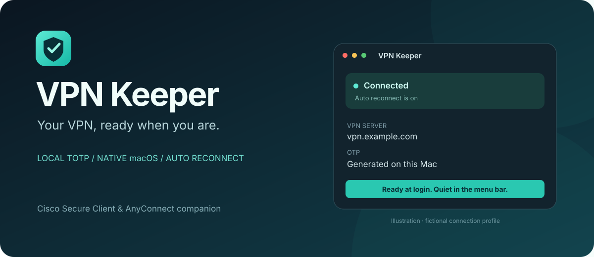

<p align="center"></p>

# VPN Keeper

Нативное приложение для строки меню macOS: запускается после входа, генерирует OTP локально и восстанавливает Cisco VPN при разрыве.

[English](../README.md) · **Русский** · [Релизы](https://github.com/adamauthor/vpn-keeper/releases) · [Устройство защиты](SECURITY-ARCHITECTURE.md)

## Возможности

- Автозапуск через стандартный механизм macOS.
- Проверка Cisco каждые 15 секунд; при сетевой ошибке — три дополнительные попытки через 30, 60 и 120 секунд.
- Локальное распознавание QR настройки TOTP и экспорта Google Authenticator.
- Выбор одного аккаунта из экспорта; остальные аккаунты не сохраняются.
- Пароль и параметры TOTP в Связке ключей этого Mac без синхронизации iCloud.
- Четыре порядка ввода OTP и обычного пароля.
- Английская раскладка при переходе в поле пароля и возвращении в приложение с активным полем.

Туннель создаёт установленный Cisco Secure Client / AnyConnect. VPN Keeper управляет его официальным CLI и проверяет подпись Cisco перед передачей данных. Проект независимый и не связан с Cisco или Google.

## Прежде чем использовать

> [!WARNING]
> **VPN Keeper хранит пароль от VPN и секрет TOTP на одном и том же Mac.**
> Смысл двухфакторной аутентификации в том, что второй фактор находится на другом устройстве. Когда оба хранятся здесь, войти в ваш VPN без телефона сможет любой, кто получит доступ к разблокированному Mac, или вредоносная программа, запущенная под вашей учётной записью. По сути двухфакторный вход превращается в однофакторный: доступ к этому Mac.

**Сначала проверьте политику вашей организации.** Многие компании запрещают выгружать секреты аутентификатора и автоматизировать одноразовые коды и могут расценить это как обход защитного механизма. Используйте VPN Keeper, только если это разрешает ваша служба безопасности. Если не уверены, спросите их до настройки.

Как снизить риск:

- Задайте надёжный пароль входа и включите FileVault.
- Блокируйте Mac, когда отходите, и настройте автоматическую блокировку после короткого простоя.
- Оставьте приложение-аутентификатор и на телефоне, чтобы сохранить доступ, если Mac потеряется.
- Если Mac потерян или скомпрометирован, сразу смените пароль от VPN и перевыпустите OTP через IT-отдел.

VPN Keeper распространяется «как есть» по лицензии MIT, без каких-либо гарантий. Вы сами отвечаете за то, чтобы использовать его в соответствии с правилами вашей организации.

## Установка

Нужны **macOS 13+** и установленный Cisco Secure Client / AnyConnect с VPN CLI.

1. Скачайте [релиз](https://github.com/adamauthor/vpn-keeper/releases) для своего Mac: `arm64` — Apple Silicon, `x86_64` — Intel. Либо соберите приложение из исходников.
2. Перенесите **VPN Keeper.app** в «Программы» и откройте.
3. Введите адрес VPN, точное имя группы, логин и обычный пароль.
4. [Получите картинку QR для TOTP](#как-получить-картинку-qr-для-totp), нажмите **«Выбрать QR…»** и укажите изображение. В экспорте Google Authenticator выберите один аккаунт VPN.
5. Выберите порядок входа. По умолчанию: **Password = OTP; Second Password = обычный пароль**.
6. Нажмите **«Подключить»**. Эта кнопка сохраняет настройки и включает восстановление соединения.
7. В системном запросе Связки ключей выберите **«Разрешать всегда» / Always Allow** для VPN Keeper.
8. Включите **«Запускать VPN Keeper после входа в macOS»**. Если macOS запросит, разрешите объект входа в Системных настройках.

Окно можно закрыть: приложение останется под значком щита в строке меню. «Выключить авто» сохраняет текущий туннель. «Отключить VPN» выключает авто и отключает Cisco.

Релизные сборки имеют локальную **ad-hoc подпись**, без Developer ID и нотариализации Apple. Отключать защиту macOS не нужно. Для требований корпоративного распространения используйте [собственную подпись и нотариализацию](BUILDING.md).

## Как получить картинку QR для TOTP

QR содержит секрет, из которого генерируются коды. Перед выгрузкой прочитайте раздел [Прежде чем использовать](#прежде-чем-использовать).

Нужен QR с **секретом настройки TOTP**, а не скриншот меняющихся 6 или 8 цифр. VPN Keeper читает стандартный QR `otpauth://totp/` и QR экспорта Google Authenticator `otpauth-migration://`. Файл резервной копии, резервный код, QR push-регистрации или QR входа — другие форматы.

### Google Authenticator

1. Откройте Google Authenticator на телефоне и его меню.
2. Выберите **«Перенести аккаунты» → «Экспорт аккаунтов»** — **Transfer accounts → Export accounts**. В некоторых версиях пункты называются **Transfer codes → Export codes**.
3. Подтвердите разблокировку телефона, оставьте выбранным **только аккаунт вашего VPN** и нажмите **«Далее» / Next**.
4. Сохраните показанный QR картинкой по инструкции ниже и откройте её в VPN Keeper через **«Выбрать QR…»**.
5. В окне импорта выберите аккаунт VPN и подтвердите выбор.

QR экспорта поддерживается напрямую: искать исходный QR регистрации не нужно. Если страниц несколько, выберите картинку с нужным аккаунтом. Аккаунт на телефоне оставьте. [Инструкция Google по переносу](https://support.google.com/accounts/answer/1066447?hl=ru).

### Другие приложения двухфакторной аутентификации

Названия пунктов зависят от платформы и версии. Ниже указано, как получить данные настройки; файлы резервных копий других приложений VPN Keeper **напрямую не импортирует**.

| Приложение | Как получить подходящий QR |
|---|---|
| **Ente Auth** | Удерживайте запись VPN на телефоне или нажмите на неё правой кнопкой на компьютере и выберите **QR**. Сохраните этот QR картинкой. Отдельный пункт **Share** создаёт временную ссылку просмотра — для импорта она не подходит. [Справка Ente](https://ente.com/help/auth/features/#scan-qr). |
| **Aegis (Android)** | Выделите запись VPN и используйте действие переноса через QR. Другой путь: **Settings → Import & Export → Export for Google Authenticator**. Если QR несколько, нужна страница с аккаунтом VPN. [Официальный проект](https://github.com/beemdevelopment/Aegis). |
| **Microsoft Authenticator** | Получите исходный QR TOTP в настройках безопасности VPN или сервиса, как описано ниже. Если Microsoft предлагает **I want to use a different authenticator app**, выберите этот вариант для стандартного TOTP. Облачная копия Microsoft Authenticator и QR регистрации push-подтверждений не подходят. [Справка Microsoft](https://support.microsoft.com/en-us/authenticator/how-to-add-your-accounts-to-microsoft-authenticator). |
| **Authy** | Экспорт токенов не предусмотрен. Получите QR настройки у исходного сервиса или обратитесь к администратору VPN для повторной регистрации. [Ограничение Authy](https://help.twilio.com/articles/19753420684059-Export-or-Import-Tokens-in-the-Authy-app). |
| **2FAS Auth** | В редактировании записи можно посмотреть секретный ключ. Скриншот этого текста и резервная копия `.2fas` не являются QR настройки. Используйте исходный QR от сервиса. [Справка 2FAS о ключе](https://2fas.com/support/2fa-knowledge/what-is-the-secret-key-and-where-is-it-in-the-2fas-app/). |
| **Bitwarden Authenticator** | **Settings → Export** создаёт JSON/CSV со строками настройки, а не картинки QR. Используйте исходный QR. Если уже есть полная строка `otpauth://totp/`, её можно превратить в QR доверенным инструментом, работающим полностью локально; сам текстовый файл VPN Keeper не читает. [Справка Bitwarden об экспорте](https://bitwarden.com/help/authenticator-import-export/). |

### Исходный QR из настроек сервиса

Войдите в портал MFA вашего VPN или настройки безопасности аккаунта текущим способом. Найдите **«Двухфакторная аутентификация» / «Приложение-аутентификатор» / «Добавить аутентификатор»**. Если сервис разрешает добавить ещё один аутентификатор, откройте его QR настройки TOTP и импортируйте картинку.

Для корпоративного VPN без самостоятельной настройки обратитесь к администратору. Повторная регистрация может заменить секрет: старая запись на телефоне перестанет работать. Завершите настройку у провайдера, обновите запись на телефоне и в VPN Keeper и проверьте доступ, прежде чем удалять старый способ входа. Сохраните рабочий способ входа или восстановления на время переноса. Отключать 2FA ради экспорта не нужно.

### Как сохранить картинку и загрузить её

- На Mac выделите область с QR сочетанием **Shift–Command–4**. На телефоне сделайте скриншот, если это разрешено приложением. Если снимки экрана заблокированы, сфотографируйте показанный QR другим доверенным устройством.
- Передайте файл на Mac приватно, например через AirDrop или USB. QR должен быть резким, целиком помещаться в кадр вместе с рамкой и не перекрываться другими элементами. Удобно использовать PNG или JPEG; также поддерживаются HEIC, TIFF и BMP, до **20 МБ и 40 мегапикселей**.
- В VPN Keeper нажмите **«Выбрать QR…»**, укажите одну картинку, выберите аккаунт VPN при появлении списка и сохраните. Импорт добавляет аккаунт в приложение; активацию или повторную регистрацию 2FA у провайдера он не выполняет.

**QR хранит многоразовый секрет: обращайтесь с ним как с паролем.** Не загружайте его на GitHub, в чаты или онлайн-конвертеры QR. После проверки подключения удалите временные картинки и экспорты, включая копии в «Фото» или облачной синхронизации. Рабочую запись в аутентификаторе оставьте.

## Будет ли пароль Связки ключей запрашиваться после каждого перезапуска?

**Нет**, если выбрать **«Разрешать всегда»**. Обычный перезапуск использует сохранённое разрешение. «Разрешить один раз» действует только для одного доступа. После пересборки или изменения подписи macOS может запросить разрешение снова. Заблокированную Связку ключей всё равно нужно разблокировать. [Описание вариантов доступа у Apple](https://support.apple.com/guide/keychain-access/if-youre-asked-for-access-to-your-keychain-kyca1243/mac).

Если разрешение понадобилось после обновления, откройте настройки и нажмите **«Сохранить»**, оставив поле пароля пустым. В системном окне выберите **«Разрешать всегда»**. Пароль Mac вводите только в системном окне. Фоновое подключение не показывает запросов Связки ключей.

При перемещении приложения выключите и снова включите его автозапуск, чтобы macOS запомнила новое расположение.

## QR и ограничения

Поддерживаются TOTP SHA1/SHA256/SHA512, 6/8 цифр, период исходного QR 10–120 секунд. Для экспорта Google Authenticator версий 1 и 2 используется период 30 секунд. Части экспорта читаются отдельно: выберите картинку с нужным аккаунтом.

HOTP, SSO/SAML, браузерный вход, push-подтверждения, аппаратные токены и нестандартные запросы не автоматизируются. Принятие сертификатов требует ручной проверки. Автопринятие баннера включайте только после прочтения баннера в Cisco.

Приложение запускается после входа в macOS. Вход до разблокировки FileVault не реализован. При ошибке авторизации, сертификата или неизвестном запросе автоматические попытки прекращаются.

Cisco сообщает состояние общего туннеля: приложение не проверяет адрес уже подключённого VPN и не переключает его на другой. Кнопка отключения воздействует на текущий туннель. Это не kill switch: трафик при разрыве не блокируется.

## Данные

QR читается на Mac через Apple Vision и не копируется в приложение. Сохраняются только выбранный TOTP-аккаунт и пароль. Данные передаются Cisco через stdin, без аргументов командной строки или временных файлов. Сырые ответы Cisco и секреты в журнал не записываются. Безопасный снимок состояния хранится в настройках приложения.

При хранении пароля и TOTP на одном разблокированном Mac оба фактора находятся на одном устройстве. Подробнее: [модель безопасности](SECURITY-ARCHITECTURE.md).

## Сборка

Нужны Command Line Tools / Xcode со Swift 6+ и подходящим SDK macOS.

```bash
git clone https://github.com/adamauthor/vpn-keeper.git
cd vpn-keeper
bash Scripts/test.sh
bash Scripts/build.sh
```

Приложение появится в `dist/VPN Keeper.app`. Сторонних зависимостей времени исполнения нет. Все тестовые QR и пароли синтетические; тесты не используют VPN или пользовательскую Связку ключей.

[Сборка и релизы](BUILDING.md) · [Диагностика и CLI](TROUBLESHOOTING.md) · [Участие в проекте](../CONTRIBUTING.md)

Не публикуйте настоящие QR, пароли, OTP-секреты или неочищенные диагностические архивы. Уязвимости сообщайте по [SECURITY.md](../SECURITY.md).

Лицензия [MIT](../LICENSE).
